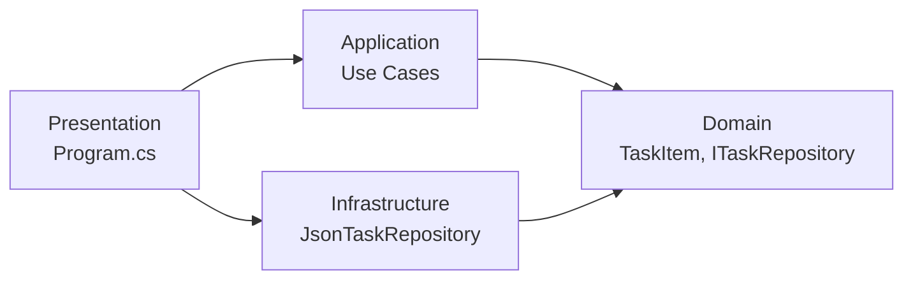

# task-manager-clean-arch
Облік завдань: Clean Architecture та робота з Git (лабораторна №5)

## Архітектура

Застосунок побудований за принципами Clean Architecture. Залежності спрямовані від зовнішніх шарів до внутрішніх.



- Domain: сутність TaskItem та інтерфейс ITaskRepository.
- Application: use cases CreateTaskUseCase, CompleteTaskUseCase, GetAllTasksUseCase.
- Infrastructure: JsonTaskRepository зберігає завдання у JSON-файлі.
- Presentation: консольна точка входу, де через конструктор збираються залежності (DI).

## Збірка і запуск

```
dotnet build
dotnet run --project src/Presentation
```

Необов'язковий аргумент задає шлях до файлу даних: `dotnet run --project src/Presentation -- my-tasks.json`
